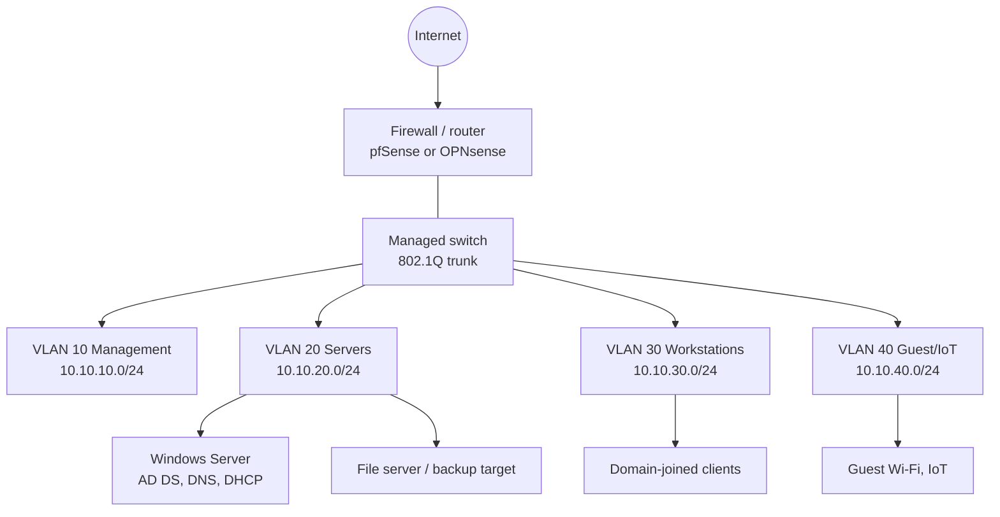

# homelab-docs

Design and build documentation for a small-business-style home lab: a firewall with segmented VLANs, a Windows domain with Active Directory, DNS and DHCP, and a tested backup strategy. The goal is to practice (and show) the full cycle of planning, building, documenting and recovering a network, the same work done for small-office clients.

> **Status:** this repo is the blueprint plus a build log. The status table below is updated as each phase is completed in the lab. Sections marked **TODO** are filled in with real configs, screenshots and lessons learned as I build.

## Architecture

## Build phases and status

| # | Phase | Doc | Status |
|---|---|---|---|
| 1 | Network design and IP plan | [01-network-design.md](docs/01-network-design.md) | Planned |
| 2 | Firewall and VLAN setup | [02-firewall-setup.md](docs/02-firewall-setup.md) | Planned |
| 3 | Active Directory, DNS, DHCP | [03-active-directory.md](docs/03-active-directory.md) | Planned |
| 4 | Backup and recovery testing | [04-backup-and-recovery.md](docs/04-backup-and-recovery.md) | Planned |
| 5 | Hardening and monitoring | see [hardening-audit](https://github.com/tylernobleit) and the SIEM lab | Planned |

Update the status column to *In progress* / *Done* as you go, and link the build log entries.

## What this lab demonstrates

- Network segmentation and least-privilege firewall rules between VLANs
- Windows domain administration: OU design, Group Policy, user lifecycle
- DNS and DHCP for a small office, including reservations and scopes
- The 3-2-1 backup rule, plus an actual restore test (a backup is only proven by a restore)
- Documentation habits: diagrams, change log, and recovery notes another technician could follow

## Hardware and software

**TODO:** list the real hardware (host machine, switch, access point) and software versions used. A virtualised lab on one PC with a hypervisor (Proxmox, Hyper-V or VirtualBox) is fine; say which one.

## Build log

Use [docs/build-log-template.md](docs/build-log-template.md) for each session. Short, dated entries showing what was tried, what broke, and how it was fixed are more convincing than polished summaries.

## Lessons learned

**TODO:** after each phase, add two or three honest lessons (what failed, what you would do differently).
